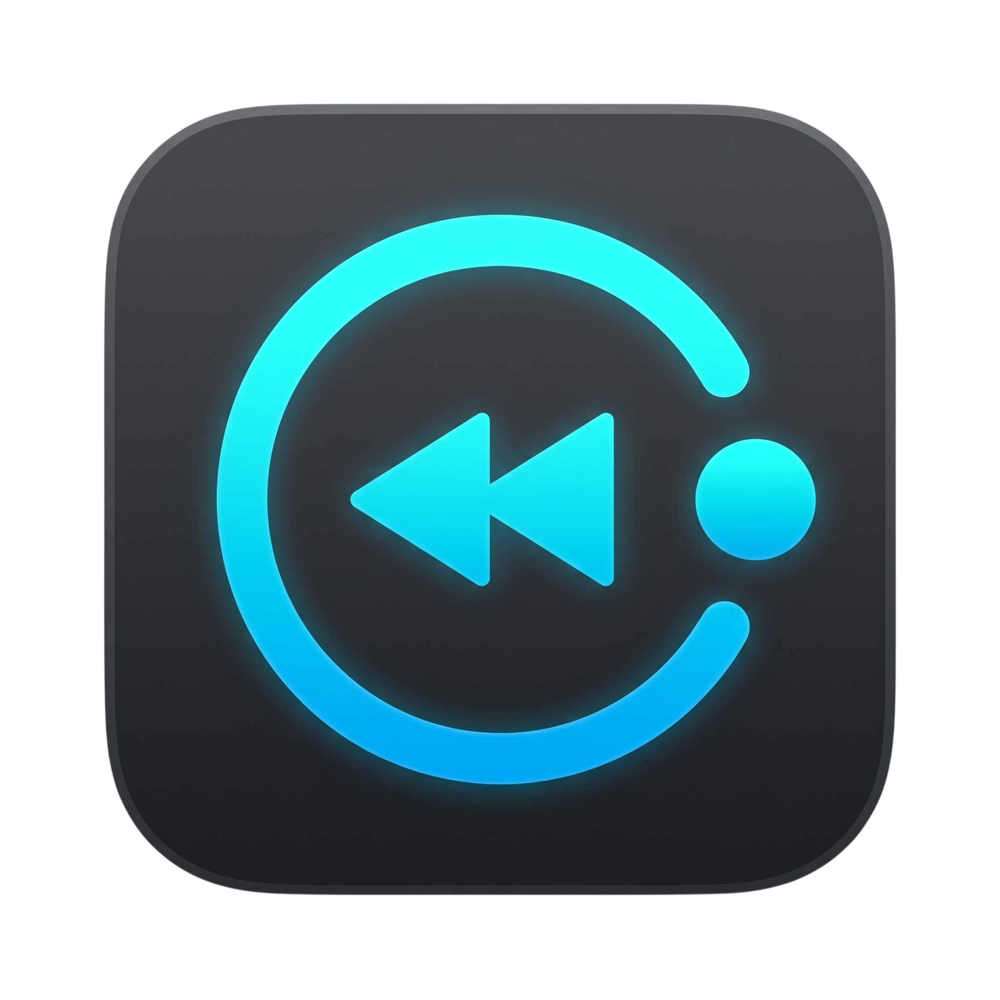

# ReplayMac



[](https://apps.apple.com/us/app/replaycap/id6789296427?mt=12)

**ReplayMac is free.** Download the full app from [GitHub](https://github.com/picccassso/ReplayMac/releases) and every feature is included out of the box. The same app is also on the [Mac App Store as ReplayCap](https://apps.apple.com/us/app/replaycap/id6789296427?mt=12), with automatic updates and a one-time purchase that supports development. See [Download](#download) for a side-by-side comparison.

ReplayMac is a macOS menu bar instant-replay clipper. It continuously buffers recent screen and audio capture, saving the last N seconds to an MP4 when triggered. Recording and save status stay visible in the menu bar, so you always know what the app is doing.

## Features

- **Instant replay and sessions:** buffer the last 15 to 300 seconds to save retroactively, or record full sessions directly to MP4. Optional 5, 10, or 30 minute replay windows can roll to disk when you need longer capture history.
- **Automatic game capture:** record gameplay automatically based on App Store categories or custom bundle IDs, with launcher exclusions and automatic stop when games exit.
- **Hardware encoding and HDR:** encode with HEVC or H.264 via VideoToolbox, with optional 10-bit Rec.2020 HLG HDR capture on Apple silicon.
- **Displays:** rank preferred displays in Settings to record the highest-priority connected screen, fall back automatically if it disconnects, and re-target across reboots, wake, and docking changes. Dual-monitor setups capture as a side-by-side composite or as separate video files, with independent per-display Retina scaling.
- **Resolutions:** record at native Retina backing-pixel resolution, logical size, half size, or custom dimensions.
- **Audio:** capture system sound and microphone together, with options to record selected apps, watch live level meters, and save audio as separate MP4 tracks.
- **Camera overlay:** add your webcam in any corner at 720p or 1080p, with optional border and rounded corners. Uses the built-in camera, a USB webcam, or Continuity Camera.
- **Feature presets:** pick Simple, Balanced, or Full, or switch individual features on and off, so ReplayMac shows only what you use.
- **Home, Clip Library, and Settings:** click ReplayMac in the Dock to open Home (or the page you choose under Settings > General > Open window to), a control centre with the same actions as the menu bar (save a replay, start or stop the buffer or a session, mute the microphone or system audio), live buffer status, each action's hotkey, and the clips you've saved since ReplayMac opened, each with a Trim button. Clip Library browses all your clips; all three open the same window. Trim & Export opens each clip in its own window, so several edits can be open at once, and exports run one at a time, keep going if you close the editor, and show progress and completion in the library.
- **Editing and export:** preview, trim, and search clips, with favorites, tags, notes, and batch actions. Drag a crop box over the preview or snap to 16:9, 1:1, 4:3, or 9:16 for MP4 and GIF exports. Export with fast passthrough or re-encode to 1080p or 720p with quality presets, HDR metadata preservation, and a live file size estimator. Share via the macOS share sheet, copy files directly to your clipboard, and clean up older clips by age or library size.
- **Native appearance:** Liquid Glass navigation and controls on macOS 26+, following your system glass appearance, accent colour, and Light/Dark mode. Earlier macOS versions use native controls.
- **Menu bar and hotkeys:** live recording state, buffer progress, and your latest clip in the menu bar. Custom hotkeys for instant replays, session recordings, time-specific buffers (15s, 60s), microphone and system audio mute (including push-to-mute), copying the last clip, and the clip library.
- **Profiles and background operation:** named capture profiles, quality presets, and file names using `{app}`, `{date}`, and `{time}` tokens. Apply capture settings during active recording, launch at login, receive save notifications, and check for GitHub updates.

### Companion App

[](https://apps.apple.com/us/app/replaycap-companion/id6821022359)

Control ReplayMac from your phone with the ReplayCap Companion app, [on the App Store](https://apps.apple.com/us/app/replaycap-companion/id6821022359) for iPhone and iPad and [on GitHub](https://github.com/picccassso/ReplayMac-Companion/releases/latest) for Android. Save replays, start and stop the buffer or a session, mute audio, and browse this session's clips from across the room or on a second screen.

- **Off until you want it:** turn on the Companion server in the Companion page. Until then, nothing listens on your network.
- **You approve every phone:** new devices show an Allow prompt on your Mac with a 4-digit code that matches the phone. Approved phones get a pairing key, and you can rename or revoke them at any time.
- **Local only:** the phone talks straight to your Mac over your own network (or a USB cable on Android). Everything stays on your network.

## Requirements

- macOS 15+ (Apple Silicon or Intel; universal binaries since version 1.6.9)
- Xcode 26 or later to build from source (macOS 26 SDK or later)

## Download

ReplayMac comes in two versions. They're the same app, built from the same source code, with identical features. Pick whichever suits you.

| | GitHub: **ReplayMac** | Mac App Store: **ReplayCap** |
| --- | --- | --- |
| Price | Free | One-time purchase |
| Features | Every feature | Every feature, identical to GitHub |
| Updates | The menu bar tells you when a new release is out, and you download it yourself | Automatic, through the App Store |
| Supporting development | Optional tips on [Ko-fi](https://ko-fi.com/picccassso) | Your purchase funds development |
| Get it | [Latest release](https://github.com/picccassso/ReplayMac/releases) | [Mac App Store](https://apps.apple.com/us/app/replaycap/id6789296427?mt=12) |

The GitHub build is notarized by Apple and opens directly on macOS. The App Store version is called ReplayCap because Apple's rules keep "Mac" out of App Store app names. If ReplayMac is useful to you, buying it on the App Store is the easiest way to support development, and you get automatic updates in return.

## Build from source

```bash
./build-app.sh
```

This compiles the app and outputs `dist/ReplayMac.app`. For local development installs, use:

```bash
./scripts/install-dev.sh
```

That builds and replaces `/Applications/ReplayMac.app` while preserving settings and permissions. To test the complete first-run flow again:

```bash
./scripts/install-dev.sh --fresh
```

Fresh mode clears onboarding state and cache, resets Screen Recording and Microphone access, keeps your saved clips, and leaves the app closed. Add `--launch` to open it after installing, or `--no-build` to install the existing `dist/ReplayMac.app`.

<details>
<summary>Screenshots</summary>

<table>
  <tr>
    <th width="50%">Home</th>
    <th width="50%">Clip library</th>
  </tr>
  <tr>
    <td width="50%"></td>
    <td width="50%"></td>
  </tr>
  <tr>
    <th width="50%">Clip details</th>
    <th width="50%">Clip saved</th>
  </tr>
  <tr>
    <td width="50%"></td>
    <td width="50%"></td>
  </tr>
  <tr>
    <th width="50%">General</th>
    <th width="50%">Video</th>
  </tr>
  <tr>
    <td width="50%"></td>
    <td width="50%"></td>
  </tr>
  <tr>
    <th width="50%">Audio</th>
    <th width="50%">Profiles</th>
  </tr>
  <tr>
    <td width="50%"></td>
    <td width="50%"></td>
  </tr>
  <tr>
    <th width="50%">Hotkeys</th>
    <th width="50%">Companion</th>
  </tr>
  <tr>
    <td width="50%"></td>
    <td width="50%"></td>
  </tr>
  <tr>
    <th width="50%">Advanced</th>
  </tr>
  <tr>
    <td width="50%"></td>
  </tr>
</table>

</details>

## Support

If you like ReplayMac and want to support its development, consider leaving a tip on [Ko-fi](https://ko-fi.com/picccassso). 🙂

## License

ReplayMac is free and source-available.

You may download, use, inspect, build, and modify it for personal use. Redistributing modified builds, publishing renamed forks, commercial sales, and using ReplayMac branding require permission.

See [LICENSE.md](LICENSE.md).
